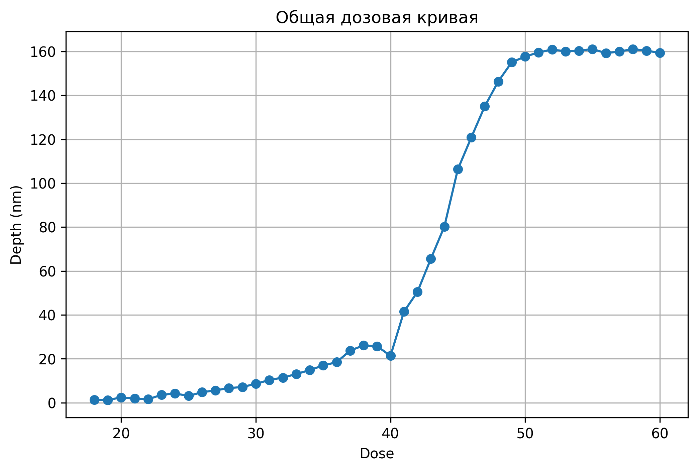
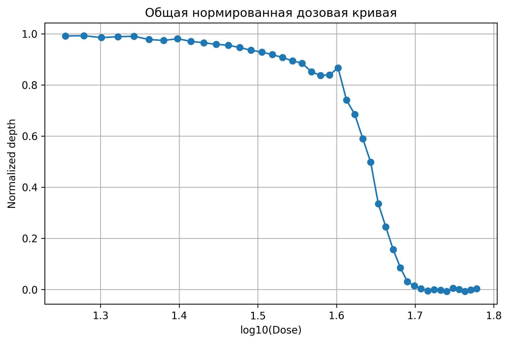
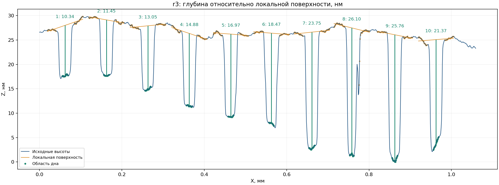

# Dose Profile Analyzer

CLI-приложение на Python для автоматизированного анализа одномерных профилей профилометрии и построения дозовых кривых. Проект ориентирован на воспроизводимую обработку экспериментальных данных: геометрия периодических элементов определяется по профилю, а глубина оценивается относительно локальной фоновой поверхности.

## Возможности

- автоматический поиск профилей `r*.txt` в папке с данными;
- чтение двухколоночных файлов X/Z с поддержкой единиц `mm`, `um`, `nm`, десятичной запятой и распространённых текстовых кодировок;
- обработка обратного направления сканирования и объединение повторяющихся координат X по медиане;
- оценка шага периодической структуры и согласование общего шага между профилями;
- робастная аппроксимация локальной поверхности и расчёт глубины каждой ступени;
- контроль качества измерений с метками `measured`, `review` и `unresolved`;
- экспорт результатов в CSV и JSON, построение графиков профилей и дозовых кривых;
- формирование HTML-отчёта с графиками и метаданными запуска;
- автоматические тесты на синтетических и граничных данных.

## Стек

**Python**, NumPy, SciPy, Matplotlib, OpenPyXL, `argparse`, `unittest` / `pytest`.

## Структура

```text
dose-profile-analyzer/
├── config.json
├── data/                  # примерные профили r1.txt ... r5.txt
├── dose_analyzer/
│   ├── cli.py             # CLI и сценарий запуска
│   ├── io.py              # чтение, нормализация и проверка входных данных
│   ├── measurement.py     # поиск сетки и измерение глубины
│   └── outputs.py         # CSV/JSON, графики и HTML-отчёт
├── results/               # пример сформированных результатов
├── tests/                 # автоматические тесты
├── main.py
└── requirements.txt
```

## Установка

Из каталога проекта создайте виртуальное окружение и установите зависимости:

```bash
python -m venv .venv
```

Windows:

```powershell
.venv\Scripts\activate
python -m pip install -r requirements.txt
```

Linux/macOS:

```bash
source .venv/bin/activate
python -m pip install -r requirements.txt
```

## Запуск

Из папки проекта выполните:

```bash
python main.py --show
```

Программа запросит минимальную дозу, максимальную дозу и шаг. Число доз должно соответствовать количеству найденных профилей: для каждого профиля предусмотрено 10 ступеней. Например, для пяти файлов `r1.txt`–`r5.txt` используется 50 значений дозы. Значения назначаются по порядку файлов; перед обработкой реального эксперимента проверьте соответствие доз лабораторному журналу.

Полезные параметры:

```bash
python main.py --help
python main.py --data data --out results
python main.py --mode grid
```

`--mode` поддерживает режимы `auto`, `grid` и `manual`. Для `manual` необходимо заранее задать интервалы измерения в конфигурации. Параметр `--show` открывает HTML-отчёт после завершения анализа.

## Результаты

По умолчанию файлы сохраняются в `results/`:

- `measurements.csv` и `measurements.json` — сводная таблица измерений;
- `r*_details.csv` — подробности по каждому профилю;
- `r*_profile.png` — диагностические профили с выделенными областями;
- `r*_curve.png` — дозовые кривые;
- `r*_curve_norm.png` — нормированные кривые с осью X `log10(дозы)`;
- `run_metadata.json` — параметры запуска и контрольные суммы входных файлов;
- `report.html` — отчёт со всеми графиками.

### Пример общей дозовой кривой



### Нормированная дозовая кривая



### Пример профиля с диагностическими отметками



Графики и таблицы в `results/` включены как пример результата обработки приложенных профилей. Они не заменяют проверку исходных данных и соответствия доз конкретному эксперименту.

## Тестирование

Установите `pytest` и запустите тесты из каталога проекта:

```bash
python -m pip install pytest
python -m pytest tests -q
```

Тесты проверяют точность измерения на синтетических профилях, устойчивость к линейному наклону и вертикальному смещению, работу с дубликатами координат, десятичной запятой и обратным сканированием, а также обработку плоского сигнала, обрезанных элементов и пропусков данных.

## Что демонстрирует проект

Проект объединяет инженерную задачу, численные методы и разработку прикладного инструмента: от валидации сырых файлов и устойчивой оценки геометрии до анализа качества измерений, визуализации и подготовки воспроизводимого отчёта.
